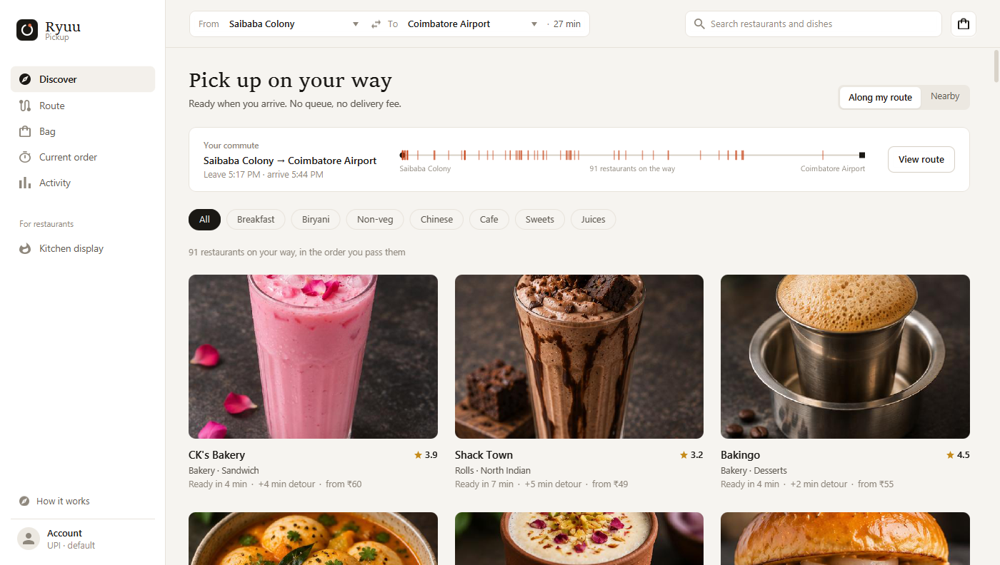
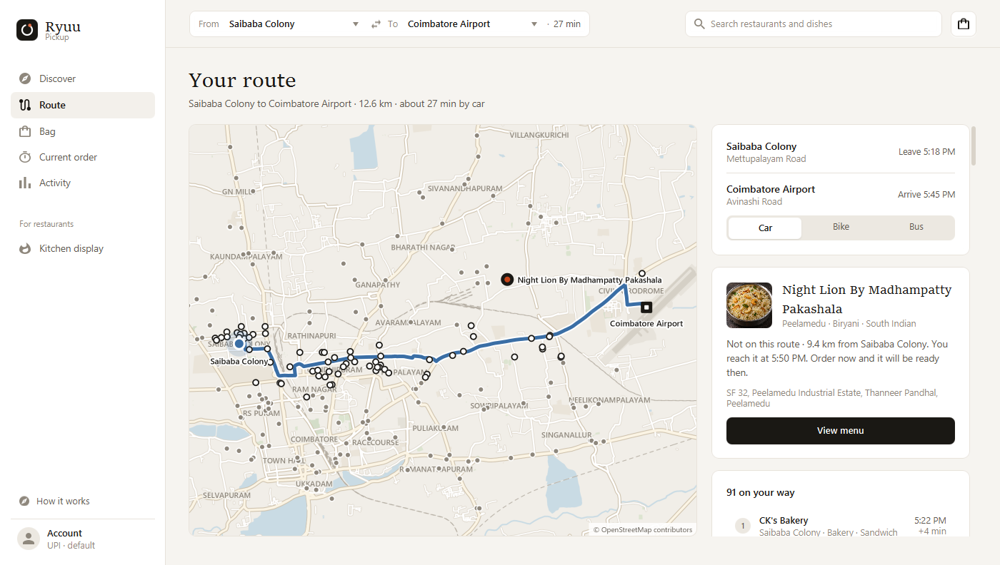
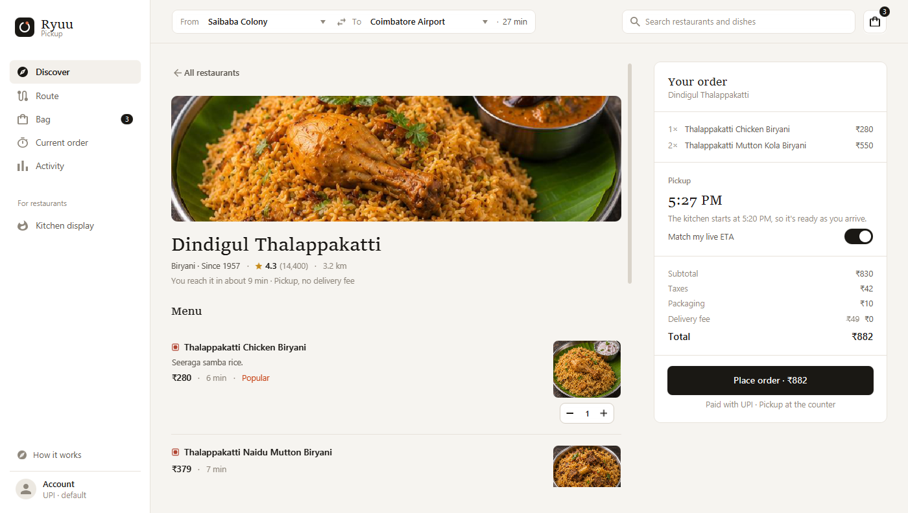
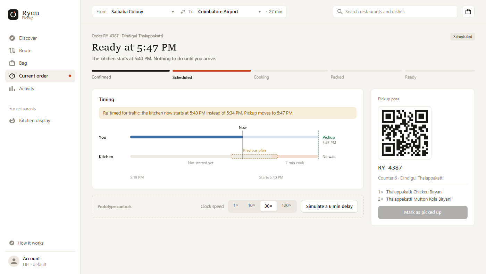
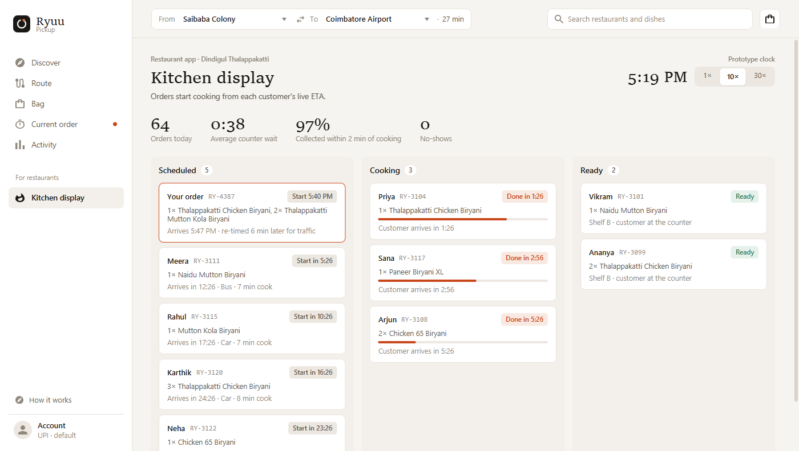

<div align="center">


# 🍱 Ryuu SmartPickup

### *order ahead · skip the wait · pick up on your way*

**A smart food pickup app for Coimbatore: order from restaurants on your route,**
**and the kitchen times your food to the moment you arrive.**

`Java 23+` · `JavaFX 26.0.2` · `OpenStreetMap (offline)` · `297 real restaurants` · `Windows`

</div>

---

## ✨ What is this?

Ryuu SmartPickup is a clickable desktop prototype of a startup idea (see [`Startup_idea.txt`](Startup_idea.txt)): people often pay for delivery not because they want it, but because they don't want to wait 10–20 minutes at the counter.

- 🛣️ **Food on your way.** Pick *From* and *To*, and see every restaurant you pass, when you pass it, and the detour.
- ⏱️ **Ready when you arrive.** The kitchen starts cooking based on your live ETA, so the food is hot when you walk in.
- 💸 **No delivery fee, no queue.** Walk in, show your pickup pass, walk out.
- 🗺️ **Works offline.** The whole Coimbatore district map (Mettupalayam to Valparai) and the route finder are built into the app.
- 🍽️ **Real places.** 297 real Coimbatore restaurants with their areas, ratings and dishes.
- 👨‍🍳 **Both sides.** A customer app *and* a kitchen display for the restaurant.

<div align="center">

<br><sub>Discover: 91 restaurants on the way from Saibaba Colony to the airport, in the order you pass them.</sub>
</div>

---

## 🧭 How an order works

```text
 You set your trip: From Saibaba Colony → To Coimbatore Airport
        │
        ▼
 ① The app finds the fastest road route on its own offline map
        │
        ▼
 ② Restaurants within ~650 m of your road are listed in the order you pass them
        │
        ▼
 ③ You order: the bag shows your pickup time and when the kitchen will start
        │
        ▼
 ④ The kitchen display sorts tickets by when you ARRIVE, not when you ordered
        │      (running late? the kitchen is re-timed automatically)
        ▼
 ⑤ Walk in, show the pickup pass, walk out. 🍱
```

<div align="center">

<br><sub>Route: the offline map with every restaurant along the road. Car, bike or bus changes the times.</sub>
</div>

---

## 📱 Screens

| Screen | What it shows |
|---|---|
| **How it works** | A 4-step story: the problem (waiting, delivery fees, uncertainty) → order on your way → kitchen timed to your ETA → walk in, walk out |
| **Discover** | Your commute at a glance, category filters, *Along my route / Nearby*, photo-led restaurant cards |
| **Route** | The map from start to destination with every restaurant you pass, when you pass it, and the detour. Travel mode changes the times |
| **Restaurant & bag** | Cover photo, menu with dish photos, and a bag that shows the pickup time and when the kitchen starts |
| **Current order** | Status, steps, the *You vs Kitchen* timing chart and a pickup pass. *Prototype controls* speed up the clock or add a 6-minute delay |
| **Activity** | Time and fees saved, two charts, recent orders |
| **Kitchen display** | The restaurant side: tickets sorted by customer arrival (Scheduled → Cooking → Ready). Your live order shows up here too |

| Menu & bag | Current order | Kitchen display |
|---|---|---|
|  |  |  |

---

## 🚀 Quick start

1. **Install** a Java JDK, version 23 or newer.
2. **Download** this repository (green *Code* button → *Download ZIP*) and unzip it.
3. **Run** it from PowerShell inside the folder:
   ```powershell
   .\run.ps1
   ```
   The first run downloads the OpenJFX 26.0.2 jars from Maven Central into `lib\`, then builds and opens the app.
4. Pick a **From** and **To** in the top bar and find something to eat on your way. 🍱

> 💡 To make a Windows `.exe`, run `.\package.ps1`. It copies the photos, `restaurants.tsv` and `coimbatore.map` next to the exe in `dist\RyuuSmartPickup\`.

---

## 🗺️ The real data (all offline)

| Data | Where | Details |
|---|---|---|
| **Map** | `assets/coimbatore.map` | Streets, lakes, parks, railways and town names for the whole Coimbatore district from OpenStreetMap, drawn by the app itself. Drag to pan, scroll to zoom; road names appear up close |
| **Route** | built from the same map | 32 real places, from Gandhipuram to Pollachi and Valparai. Fastest road route, one-way streets respected |
| **Restaurants** | `assets/restaurants.tsv` + `Data.java` | 291 exported from public Zomato listings on 2026-11-25 (name, area, address, coordinates, rating, votes, up to 12 dishes each with veg flags) + 7 hand-finished ones (one duplicate skipped) |
| **Prices & prep times** | in the app | Illustrative: varied from the listed prices, not what the restaurants charge |
| **Photos** | `assets/photos/` | Illustrative. Shown only when the dish name clearly matches; other dishes appear without a photo |

---

## 🗂️ Project map

```text
Ryuu_SmartPickup\
├── README.md                 ← you are here
├── LICENSE                   ← copyright & terms of use (all rights reserved)
├── Startup_idea.txt          ← the startup idea: problem, solution, users
├── run.ps1 · start.bat       ← build & run
├── package.ps1               ← build the Windows exe into dist\
├── assets\
│   ├── coimbatore.map        ← packed OpenStreetMap data (ODbL)
│   ├── restaurants.tsv       ← 291 restaurants
│   └── photos\               ← restaurant covers and dish photos
├── src\com\ryuu\pickup\
│   ├── App.java              ← window, sidebar, top bar, transitions, toasts
│   ├── AppState.java · Order.java ← cart, active order, simulated clock
│   ├── *View.java            ← one class per screen
│   ├── FoodArt.java · LiveCanvas.java · Backdrop.java ← drawn art and animation
│   └── app.css               ← the whole theme ("dragon fire at midnight")
├── tools\PackMap.java        ← turns OpenStreetMap extracts into coimbatore.map
└── docs\screenshots\
```

---

## 🛠️ For tinkerers

| I want to… | Do this |
|---|---|
| Add real photos | Put `<restaurant-id>.jpg` (ids: `dosa`, `juice`, `brew`, `biryani`, `green`, `momo`, `wok`, `paratha`) or a dish slug like `ghee-roast-dosa.png` into `assets\photos\`. The exe reads them from `dist\RyuuSmartPickup\assets\photos\` |
| Change colours or fonts | Edit `src\com\ryuu\pickup\app.css`, then run again |
| Refresh the map | Download the Overpass extracts described at the top of `tools\PackMap.java`, then `java tools/PackMap.java roads.json areas.json assets/coimbatore.map` |
| Screenshot every screen | Run with `-Dryuu.snap=<folder>` |

---

## 📜 Credits & licences

- **Map data:** © [OpenStreetMap](https://www.openstreetmap.org/copyright) contributors, [Open Database License (ODbL)](https://opendatacommons.org/licenses/odbl/). `coimbatore.map` is a derived database under the same licence.
- **Restaurant facts:** from public Zomato listings. Restaurant names and brands belong to the restaurants; this prototype is not affiliated with Zomato or any restaurant.
- **Photos:** illustrative only, not supplied by the restaurants.
- **UI toolkit:** OpenJFX, GPL v2 + Classpath Exception.
- **App, design and idea:** made for this project by its creator.

---

## 📄 Copyright & Terms of Use

**© 2026 Adithya V. All Rights Reserved.**

This repository is published for portfolio, demonstration, and educational viewing purposes only. You are welcome to view the source code to understand the implementation.

**You MAY** download, install and run it on your own computer for your own **personal, non-commercial use**.

**You may NOT:**

- Copy or reproduce substantial portions of this project.
- Redistribute, republish, or mirror this repository.
- Use this code or the startup idea in commercial projects without prior written permission.
- Submit this code, or substantially similar code, as your own for academic purposes.
- Remove copyright notices or claim this work as your own.
- Share, sell or re-upload it (including copies downloaded for personal use), or change the source code and use or share the changed version.

If you would like to use any part of this project, please contact me first for permission.

The full legal terms are in the [**LICENSE**](LICENSE) file.

> Third-party parts keep their own owners and licences: the map data (© OpenStreetMap contributors, ODbL), restaurant names and brands (their owners) and OpenJFX (GPL v2 + Classpath Exception). See **Credits & licences** above.

<div align="center">

*Made in Coimbatore, for people on the move.* 🍱

</div>
